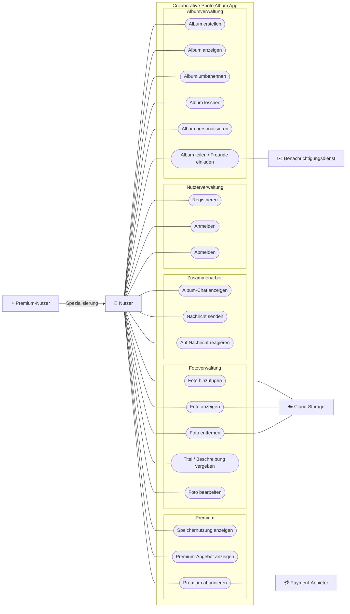

# Requirements – Collaborative Photo Album App

## 1. Stakeholder und Systemgrenze

Die Collaborative Photo Album App ermöglicht Nutzern, gemeinsame
Fotoalben für Erlebnisse wie Reisen, Partys oder Festivals zu erstellen.

Das System umfasst unter anderem Albumverwaltung, Fotoverwaltung,
Nutzerverwaltung, Zusammenarbeit und Premium-Funktionen.

Externe Dienste wie Cloud-Speicher, Zahlungsabwicklung und
Benachrichtigungsversand werden über Schnittstellen angebunden.

## 2. Use-Case-Analyse

### 2.1 Akteure

**Nutzer**

Ein Nutzer kann Alben erstellen und verwalten, Fotos hinzufügen und
bearbeiten, mit anderen Album-Mitgliedern kommunizieren und Alben teilen.

**Premium-Nutzer**

Ein Premium-Nutzer ist ein Nutzer mit einem Premium-Abonnement und
erhält insbesondere ein höheres Speicherlimit.

**Payment-Anbieter**

Ein externer Payment-Anbieter übernimmt die Zahlungsabwicklung für
Premium-Abonnements.

**Cloud-Storage**

Ein externer Cloud-Storage-Dienst speichert die von Nutzern
hochgeladenen Fotos.

**Benachrichtigungsdienst**

Ein externer Dienst unterstützt beispielsweise den Versand von
Einladungen.

### 2.2 Use-Case-Diagramm

### 2.3 Pflichtfunktionalitäten

Die folgenden Use Cases decken die in der Projektbeschreibung
definierten Pflichtfunktionalitäten ab:

- UC-01: Album erstellen
- UC-02: Album anzeigen
- UC-03: Album umbenennen
- UC-04: Album löschen
- UC-07: Foto hinzufügen
- UC-08: Foto anzeigen
- UC-09: Foto entfernen
- UC-10: Titel / Beschreibung vergeben

Ungültige Eingaben und definierte Fehlerfälle werden innerhalb der
jeweiligen Use Cases als Alternativabläufe beschrieben.

## 3. Use-Case-Beschreibungen

### UC-07 – Foto hinzufügen

**Primärer Akteur:** Nutzer

**Ziel:** Ein Foto zu einem bestehenden Album hinzufügen.

**Vorbedingung:** Das gewünschte Album existiert und ist geöffnet.

**Nachbedingung:** Das ausgewählte Foto wurde dem Album hinzugefügt.

#### Standardablauf

1. Der Nutzer wählt „Foto hinzufügen“.
2. Das System zeigt die Möglichkeit zur Auswahl eines Fotos.
3. Der Nutzer wählt ein Foto aus.
4. Das System prüft das ausgewählte Foto auf Gültigkeit.
5. Das System fügt das gültige Foto dem Album hinzu.
6. Das System zeigt das Album mit dem hinzugefügten Foto an.

#### Alternativablauf A1 – Ungültiges Foto

Bei Schritt 4:

1. Das System erkennt, dass das ausgewählte Foto ungültig ist.
2. Das System zeigt eine fachlich verständliche Fehlermeldung an.
3. Das Album bleibt unverändert.

#### Alternativablauf A2 – Hinzufügen fehlgeschlagen

Bei Schritt 5:

1. Das System kann das Foto nicht zum Album hinzufügen.
2. Das System zeigt eine fachlich verständliche Fehlermeldung an.
3. Das Album bleibt unverändert.

## 4. Abgeleitete funktionale Anforderungen

**FA-01 – Foto hinzufügen**

Das System muss ein vom Nutzer ausgewähltes gültiges Foto dem aktuell
geöffneten Album hinzufügen.

**Herkunft:** UC-07, Standardablauf Schritt 5.

**FA-02 – Ungültiges Foto**

Erkennt das System ein ungültiges Foto, muss es eine fachlich
verständliche Fehlermeldung anzeigen und das Album unverändert lassen.

**Herkunft:** UC-07, Alternativablauf A1.

**FA-03 – Voraussetzung für Foto-Upload**

Das System darf das Hinzufügen eines Fotos nur ermöglichen, wenn ein
bestehendes Album geöffnet ist.

**Herkunft:** UC-07, Vorbedingung.
